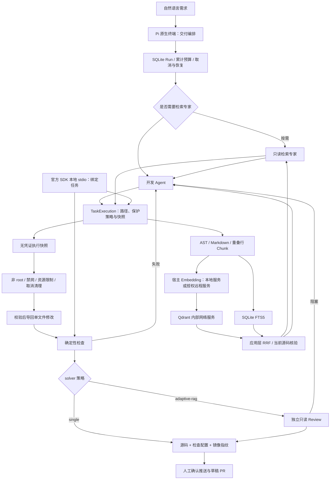

# 已实现的执行与证据路径

模型凭证、Git 与 GitHub 发布由宿主编排层管理，不进入任务容器。Qdrant 使用独立内部网络与 E 盘 Docker Linux 数据卷；受限代理不挂载宿主目录。图中的专家与 Dense 路径都是有条件路径；缺少 Embedding 授权/配置时只有显式关键词降级。代码变更任务的检索上下文优先展示实现文件；索引更新已核验快照后复用其命中，避免重复读取候选文件。

single-no-rag 跳过检索与独立 Review，single-rag 加入检索，adaptive-rag 加入独立 Review 与按需专家。三者使用相同执行边界和外部功能验收，功能通过与交付 Gate 分开报告。专家收益由真实对照结果决定，不能从调用数量推断。见 [本地评测](LOCAL-EVALUATION.md)。
